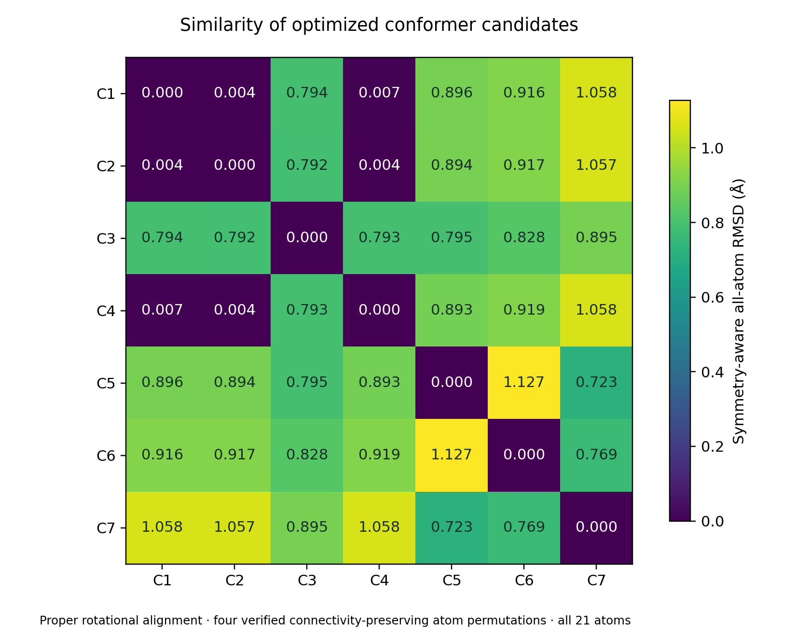

# CID 75791 — Results and Discussion

## Study scope and overall result

The supplied neutral C₉H₈O₄ structure (CID 75791) was treated as a closed-shell singlet. An initial optimization and frequency calculation was followed by 23 completed ORCA jobs covering electronic properties, charged and triplet states, gas/water TD-DFT, Raman activities, NMR shieldings with a TMS reference, and additional conformer candidates. These are computational predictions rather than experimentally validated measurements.

The original gas-phase structure is a local minimum: all 57 vibrational modes are positive, with the lowest at 29.07 cm⁻¹. The electronic-property reference is this original local minimum. The additional conformer calculations expand the sampled landscape but do not establish a global minimum or a complete statistical ensemble.

| Quantity | Calculated result | Model / scope |
| --- | --- | --- |
| Gas-phase dipole | 2.277 D | wB97X-D3/def2-TZVPD |
| Water-model dipole | 3.610 D | Relaxed neutral structure; CPCM |
| Neutral gas orbital gap | 10.4548 eV | Kohn–Sham eigenvalue difference |
| Lowest gas singlet transition | 5.428375 eV; 228.4 nm | Full TD-DFT, vertical excitation |
| Vertical IP | 9.128 eV | ΔSCF at the neutral geometry |
| Vertical EA | -0.957 eV | Unfavorable finite-basis attachment estimate |
| Validated candidate structures | 7 | Includes repeated and mirror-related geometries |

## 1. Optimized geometry and bonding

The optimized carboxylic-acid groups retain distinguishable carbonyl and hydroxyl C–O bonds. C9–O3 and C10–O4 are 1.2019 and 1.2059 Å, whereas C9–O1 and C10–O2 are 1.3554 and 1.3514 Å. The O–H distances are 0.9705 and 0.9710 Å. These geometries are consistent with the protonated acid structure supplied as input; they do not predict aqueous protonation populations.

The six phenyl-ring C–C distances lie between 1.3895 and 1.3959 Å. Their narrow range is compatible with an aromatic ring geometry, although the supplied SDF represents the ring using an alternating bond-order drawing. The C5–C6 connection to the phenyl group is 1.5140 Å, and the two C5–carboxyl-carbon distances are approximately 1.525 Å. Atom labels are one-based and match the report illustrations and geometry tables.

The geometry should be described as a calculated local minimum. Positive frequencies do not establish the absence of lower-energy conformers, nor do they validate an experimental crystal or solution structure. Complete bond-length and bonded-angle tables are included in the data archive.

## 2. Conformer comparison: repeated and mirror-related structures

All seven candidate frequency calculations have zero imaginary modes. Their printed Gibbs energies span 1.600 kcal/mol. This spread is a comparison of the sampled local structures at the same r²SCAN-3c level and thermochemical settings; it is not a probability distribution.

| Website label | Calculation source | Relative E / kcal mol⁻¹ | Relative G / kcal mol⁻¹ |
| --- | --- | --- | --- |
| C1 | 15_conformer_120_0 | 0.000 | 0.000 |
| C2 | 19_conformer_120_120 | 0.007 | 0.030 |
| C3 | initial_optimization | 0.007 | 0.060 |
| C4 | 17_conformer_0_120 | 0.020 | 0.093 |
| C5 | 18_conformer_0_240 | 0.332 | 0.477 |
| C6 | 16_conformer_240_0 | 0.829 | 0.886 |
| C7 | 20_conformer_240_240 | 1.577 | 1.600 |

A further structure comparison used all 21 atoms, including the hydroxyl hydrogens. Four element- and connectivity-preserving atom permutations were checked, with equivalent aromatic Kekulé drawings treated identically. Translation and proper rotation were removed by least-squares alignment. At an explicitly chosen all-atom RMSD threshold of 0.10 Å, C1, C2 and C4 form one near-duplicate group: their pairwise RMSDs are approximately 0.004–0.007 Å. The resulting five proper-rotation groups are descriptive geometric groups, not a claim of five independently established thermodynamic conformers.

C3, the original reference structure, is also approximately mirror-related to C1: allowing an improper alignment reduces their all-atom RMSD from about 0.794 Å to 0.002 Å. Reflections were used only for this separate diagnostic and were not allowed in duplicate grouping. The small printed differences of roughly 0.007 kcal/mol in electronic energy and 0.060 kcal/mol in Gibbs energy between these mirror-like snapshots should not be used to claim a physical stereochemical preference.

Boltzmann populations have therefore not been reported. Such populations would require a deduplicated, sufficiently complete ensemble, a clear treatment of mirror-related structures and degeneracy, and thermochemistry consistent with the intended environment. The geometric grouping threshold and all pairwise values are supplied for inspection.

## 3. Frontier orbitals and electronic response

At wB97X-D3/def2-TZVPD, the original neutral gas-phase HOMO is -9.3400 eV and the LUMO is 1.1148 eV, giving an orbital eigenvalue gap of 10.4548 eV. These values must remain associated with that method and geometry. The r²SCAN-3c job has different orbital energies; mixing its values with the hybrid results would create an inconsistent descriptor.

The HOMO/LUMO images visualize finite-basis Kohn–Sham orbitals. Their two colors denote orbital phase, not positive and negative electric charge. The positive LUMO eigenvalue is an additional reason not to interpret the virtual orbital as a proven bound electron-attached state. The orbital eigenvalue gap is not the calculated optical excitation energy and should not be presented as a material band gap.

The lowest gas-phase TD-DFT singlet appears at 5.428375 eV, substantially below the orbital gap. Its printed orbital-configuration contributions include 45a → 47a (0.323389), 46a → 49a (0.302211), and HOMO 46a → LUMO 47a (0.108507). The transition is therefore not described well by a single HOMO→LUMO label. ORCA indices here are zero-based, and the tabulated quantities are the contributions printed by ORCA, not oscillator strengths or measured state probabilities.

Method reference: [ORCA TD-DFT spectroscopy documentation](https://www.faccts.de/docs/orca/6.1/manual/contents/spectroscopyproperties/tddft.html).

## 4. Atomic charges, electrostatic maps and solvent response

All four oxygen atoms have negative Hirshfeld charges in the gas-phase reference. The carbonyl oxygens O3 and O4 carry −0.27219 and −0.28468 e, while the hydroxyl oxygens O1 and O2 carry −0.18152 and −0.17544 e. The carboxyl carbons C9/C10 carry about +0.237 e, and the hydroxyl hydrogens H20/H21 about +0.185 e. This partition provides a qualitative description of polarization; it is not a direct experimental measurement or a standalone reaction-site prediction.

The neutral CPCM-water calculation gives a dipole of 3.610 D compared with 2.277 D in gas phase. The corresponding isotropic polarizabilities are 162.145 and 116.289 a.u. Both results use the same hybrid electronic settings, but their geometries and continuum response differ. This is a model-specific comparison of the neutral acid, not a universal molecular response in every aqueous protonation state.

Electrostatic-potential images use the 0.001 e/bohr³ electron-density isosurface and a common display range of −0.05 to +0.05 a.u. Red denotes negative electrostatic potential and blue positive potential. This color scale is distinct from the phase colors of molecular orbitals. The displayed surfaces were sampled from ORCA-generated grids and triangulated for visualization.

Mayer population indices are retained in the archive and report for transparency. Several printed indices, including some negative values, do not support a simple chemical-bond classification in this diffuse-basis calculation. The SDF connectivity and optimized geometry are used for molecular drawings; the Mayer table is not interpreted as a literal set of bond multiplicities.

Method reference: [ORCA population analysis definitions](https://www.faccts.de/docs/orca/6.1/manual/contents/spectroscopyproperties/population.html).

## 5. Infrared and Raman vibrations

The starting minimum has 57 nonzero modes, as expected for a nonlinear 21-atom molecule. Frequencies are unscaled harmonic predictions. Inspection of the calculated displacement vectors associates modes 53/54 at approximately 1800.50/1829.59 cm⁻¹ with strong carbonyl-bond motion, and modes 61/62 at approximately 3735.66/3743.00 cm⁻¹ with O–H stretching. These are projection-based characterizations, not experimentally verified assignments.

| Mode | Frequency / cm⁻¹ | IR intensity / km mol⁻¹ | Largest geometric bond projection |
| --- | --- | --- | --- |
| 54 | 1829.59 | 268.60 | O3–C9 |
| 39 | 1141.95 | 267.27 | O1–C9 |
| 38 | 1120.38 | 233.55 | O2–C10 |
| 53 | 1800.50 | 225.67 | O4–C10 |
| 21 | 633.99 | 108.99 | O2–C10 |
| 20 | 628.33 | 92.31 | O1–C9 |

Static IR and Raman figures use Lorentzian display broadening with a 20 cm⁻¹ full width at half maximum. Changing the interactive broadening changes the displayed line shape, not the underlying computed frequencies. Raman outputs are scattering activities, not laser- and temperature-specific experimental intensities. The normal-mode player uses normalized displacement directions and an illustrative amplitude at a slowed playback speed.

Method reference: [ORCA vibrational spectroscopy and Raman documentation](https://www.faccts.de/docs/orca/6.1/manual/contents/spectroscopyproperties/vibrations.html).

## 6. UV absorption and configuration mixing

For gas phase, the lowest of the 40 calculated singlet excitations is 228.4 nm (5.428375 eV), with oscillator strength 0.001624. The strongest of the 40 transitions is 180.3 nm, with oscillator strength 0.580779. These features lie in the ultraviolet.

For the neutral CPCM-water model, the lowest of the 40 calculated singlet excitations is 228.6 nm (5.423230 eV), with oscillator strength 0.000974. The strongest of the 40 transitions is 183.9 nm, with oscillator strength 0.857101. These features lie in the ultraviolet.

The lowest transition changes only slightly between these two models, whereas the stronger far-UV features shift more visibly. The displayed spectra use Gaussian broadening with a default FWHM of 0.20 eV in the interactive report; the exported static UV figures use 0.25 eV as stated in their captions. The two display choices do not change the transition energies or oscillator strengths. Individual transitions and all printed configuration components are provided as CSV data.

Assignments such as π→π*, n→π* or charge transfer are not inferred from wavelength or a single orbital image alone. More specific assignments would require examination of the relevant orbitals or transition densities, ideally with natural transition orbital analysis. No experimental absorption maximum, extinction coefficient calibration, excited-state geometry or fluorescence calculation is claimed.

## 7. NMR shieldings and referenced shifts

Gas-phase GIAO shieldings were computed at PBE0/pcSseg-2. The matched calculated TMS reference gives average isotropic shieldings of 31.427 ppm for H and 185.397 ppm for C. The report uses the approximation δ = σ(TMS) − σ(sample). The carbonyl carbons C9/C10 are predicted at 179.775/181.972 ppm; the phenyl carbons span 138.150–143.041 ppm; the methine carbon C5 is 61.284 ppm.

The methine hydrogen H14 is predicted at 4.827 ppm, the five phenyl hydrogens at 7.496–8.205 ppm, and the two O–H hydrogens at 5.974/6.240 ppm. These atom-specific values belong to one gas-phase local geometry. Solvent effects, conformer averaging, exchange and spin–spin couplings are not included, so the equal-height stick plots should not be described as full experimental NMR simulations.

Oxygen results are unreferenced isotropic shieldings, not oxygen chemical shifts. They are 117.697, 113.513, −117.500 and −98.135 ppm for O1–O4. Their anisotropies are supplied separately. No oxygen reference compound was calculated.

Method reference: [ORCA NMR documentation](https://www.faccts.de/docs/orca/6.1/manual/contents/spectroscopyproperties/nmr.html).

## 8. Ionization, electron affinity and the triplet candidate

| Property | Vertical / eV | Relaxed electronic / eV |
| --- | --- | --- |
| Ionization potential | 9.127593 | 8.891258 |
| Electron affinity | -0.956880 | -0.886417 |
| Local triplet relative energy | Not evaluated as a vertical triplet gap | 3.813652 |

IP is E(cation) − E(neutral), and EA is E(neutral) − E(anion). The vertical values use the neutral geometry; relaxed estimates use r²SCAN-D4/ma-def2-TZVP charged/triplet geometries followed by hybrid single-point energies. The cation relaxation lowers the electronic IP estimate by approximately 0.236 eV. The anion relaxation improves EA by approximately 0.070 eV, but both EA estimates remain negative.

Convergence of the finite-basis anion does not demonstrate a physically bound isolated anion. EA-derived hardness, softness and electrophilicity are therefore labeled exploratory. The quoted relaxed energy differences lack ionic frequency/thermal corrections and do not represent Gibbs energies, standard redox potentials or pKa values.

The refined doublet cation and anion have reported ⟨S²⟩ values of 0.773269 and 0.762831, compared with the ideal doublet value 0.750000. The refined triplet gives 2.062782, compared with 2.000000. These are SCF spin diagnostics, with the interpretive limitations for DFT noted by ORCA; they do not prove the global lowest spin state or the absence of alternative electronic solutions.

## 9. Thermochemistry and low-frequency sensitivity

| Quantity | Gas phase | Neutral CPCM water |
| --- | --- | --- |
| Temperature K | 298.15 | 298.15 |
| Pressure atm | 1.00 | 1.00 |
| Zero point energy Eh | 0.15775174 | 0.15729367 |
| Entropy term TS Eh | 0.04973690 | 0.04989241 |
| Electronic energy Eh | -648.60605648 | -648.62770324 |
| Enthalpy Eh | -648.43587650 | -648.45797665 |
| Gibbs energy Eh | -648.48561341 | -648.50786906 |

The printed thermochemistry uses 298.15 K and 1 atm. The ORCA output explicitly enables quasi-RRHO treatment; the reported entropy entry is T·S in Eh, not entropy S. Several modes are at low frequency, so very small conformer free-energy differences can depend on numerical convergence and the treatment of soft motions. The printed values are retained rather than promoted to precise experimental free-energy rankings.

Absolute electronic energies, enthalpies and Gibbs energies should only be compared under compatible methods, species and standard-state assumptions. The gas/water Gibbs-energy difference is not presented as a rigorously defined solution-standard-state solvation free energy. These calculations also do not supply a reaction free energy, acid dissociation free energy or binding free energy.

Method reference: [ORCA thermochemistry and quasi-RRHO treatment](https://www.faccts.de/docs/orca/6.1/manual/contents/structurereactivity/thermochemistry.html).

## 10. Website-ready interpretation

A defensible short description is: “A computational DFT case study of neutral CID 75791, including a frequency-validated local geometry, molecular orbitals and electrostatic surfaces, calculated IR/Raman/UV spectra, referenced H/C NMR shifts, solvent-model comparisons and a finite conformer comparison. Numerical predictions are accompanied by their methods and source files.”

Avoid claims of a proven global minimum, seven unique conformers, experimental spectral agreement, a material band gap, bound anion stability, biological activity, pKa or calibrated redox potential. The supplied figure captions specify model chemistry, environment, display choices and the distinctions between orbital phase, atomic charge and electrostatic potential.

The data archive retains the initial calculation plus 23 follow-up jobs, inputs, coordinates, Hessians where produced, and raw logs. The accompanying BibTeX file merges 24 unique bibliography entries emitted by the actual ORCA jobs. The reported thresholds and extraction conventions are documented so that the figures remain traceable to their numerical sources.
